# Administrador · Configura el módulo sin programar

# 1. Antes de empezar

## Tu papel en el módulo

Eres quien **deja el módulo listo para que los demás trabajen** y quien puede ajustarlo después. Casi todo lo que cambia el comportamiento del módulo se configura desde pantallas, **sin programar**: listas de opciones, reglas, plantillas, avisos, calendario del año y más.

Tu entrada es el **Centro de configuración**.

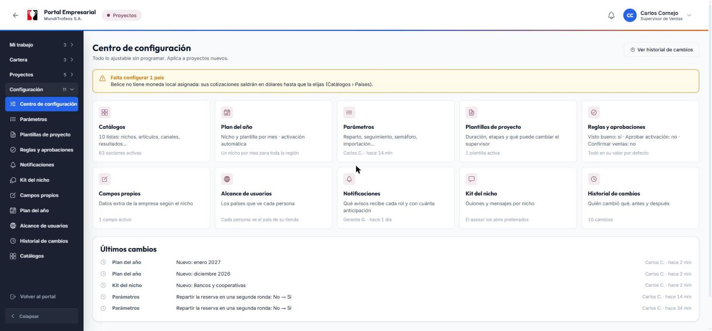

Cada tarjeta lleva a una pantalla. Abajo ves los **últimos cambios** que se hicieron y quién los hizo. Si falta algo importante (por ejemplo, un país sin moneda), arriba aparece un aviso amarillo que te dice qué configurar.

## El menú de configuración

Tu menú tiene una categoría **Configuración** con once opciones. Las categorías se abren de a una; al entrar a una pantalla, su categoría se abre sola.

| Opción | Para qué sirve |
|---|---|
| **Centro de configuración** | El inicio: resumen, avisos y últimos cambios |
| **Parámetros** | Números y reglas del reparto, el seguimiento y los informes |
| **Plantillas de proyecto** | Moldes para crear proyectos: duración, etapas y qué puede cambiar el supervisor |
| **Reglas y aprobaciones** | Interruptores del flujo: visto bueno, aprobación y confirmación de ventas |
| **Notificaciones** | Qué avisa el sistema, a quién y con cuánta anticipación |
| **Kit del nicho** | Guion de llamada y mensajes por nicho |
| **Campos propios** | Datos extra de la empresa según el nicho |
| **Plan del año** | Qué nicho toca cada mes y la activación automática |
| **Alcance de usuarios** | Qué países ve cada persona |
| **Historial de cambios** | Quién cambió qué, antes y después (con opción de restaurar) |
| **Catálogos** | Las listas de opciones: nichos, artículos, canales, resultados… |

> **Importante:** casi todo lo que cambies **aplica a los proyectos nuevos**. Un proyecto que ya está activo conserva una **copia de la configuración con la que nació**, para que sus reglas no cambien a mitad de camino.

## Una regla de oro

Todo cambio queda en el **Historial de cambios** con tu nombre y la fecha. Si te equivocas, casi siempre puedes **restaurar el valor anterior** desde ahí.

# 2. Dar acceso al módulo (una sola vez)

El módulo viene **apagado**: existe pero ningún rol lo ve hasta que alguien le da los permisos. Es una tarea de quien administra el portal y se hace desde la pantalla **Roles**, en Administración.

## Qué permiso lleva cada rol

| Permiso | Administrador | Asesor | Supervisor | Gerente |
|---|:-:|:-:|:-:|:-:|
| Entrar al módulo (`proyectos.ver`) | ✓ | ✓ | ✓ | ✓ |
| Registrar empresas | ✓ | ✓ | ✓ | |
| Importar empresas | ✓ | | ✓ | |
| Gestionar las empresas que le tocaron | | ✓ | ✓ | |
| Crear, activar, cancelar y cerrar proyectos | ✓ | | ✓ | |
| Reasignar empresas | ✓ | | ✓ | |
| Ver el avance del equipo | | | ✓ | |
| Ver todo en solo lectura | ✓ | | | ✓ |
| Dar el visto bueno a un cierre | | | | ✓ |
| Ver y exportar informes | ✓ | | ✓ | ✓ |
| Anular registros equivocados | ✓ | | ✓ | |
| Aprobar activaciones | ✓ | | | ✓ |
| Confirmar ventas | ✓ | | ✓ | |
| Todo el Centro de configuración | ✓ | | | |

## Pasos

1. Antes de abrir el módulo a los demás, **deja lista la configuración** (los capítulos siguientes): moneda de cada país, plantilla predeterminada, catálogos y alcance de usuarios.
2. Abre **Administración › Roles** y asigna los permisos de la tabla, **un rol a la vez**. Al guardar, quien esté conectado lo ve sin reiniciar nada.
3. Avisa a la gente: «Ya está disponible Proyectos. Si no ves la tarjeta, cierra sesión y vuelve a entrar.»
4. Prueba con una cuenta de cada rol.

> **Tip:** empieza en **staging** (el ambiente de pruebas) y pasa a producción cuando todo esté bien. El primer proyecto real conviene hacerlo con un solo supervisor y una tienda.

> **Nota:** si necesitas desactivarlo, quita los permisos del rol: el módulo desaparece y **los datos no se tocan**.

# 3. Catálogos: las listas de opciones

Aquí viven todas las listas que se eligen en el módulo.

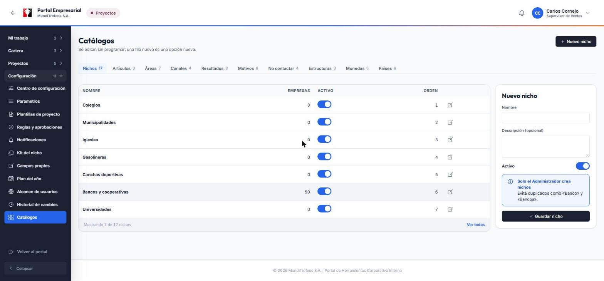

Hay una pestaña por lista: **Nichos, Artículos, Áreas, Canales, Resultados, Motivos, No contactar, Estructuras, Monedas y Países**.

- **Agregar:** escribe el nombre en el formulario de la derecha y toca **Guardar**. Una fila nueva es una opción nueva.
- **Editar o desactivar:** usa el lápiz o el interruptor **Activo**. **Desactivar no borra nada**: la opción ya no se ofrece, pero los datos viejos que la usan se conservan.
- **Orden:** el número de la derecha define en qué orden se ofrece.

> **Importante:** crea un nicho solo una vez y con un nombre claro. Evita duplicados como «Banco» y «Bancos».

### Países y monedas

En la pestaña **Países** asigna a cada país su **moneda local** y su formato de teléfono. Un país sin moneda sale en dólares hasta que lo configures, y el Centro de configuración te lo recuerda con un aviso amarillo.

# 4. Parámetros

Aquí se ajustan los números y las reglas del reparto, el seguimiento, el semáforo y los informes.

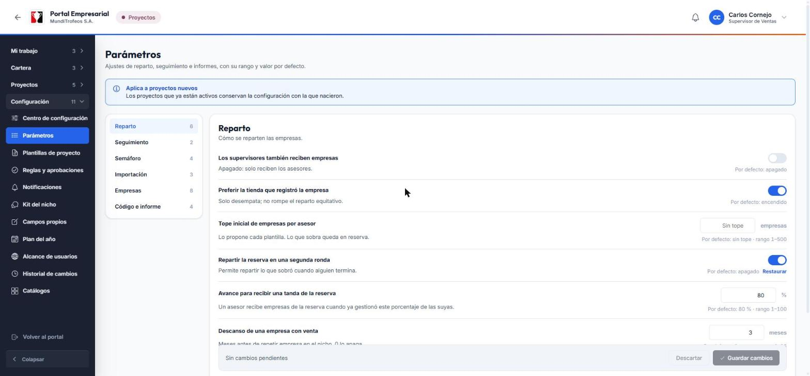

Los parámetros están en grupos: **Reparto, Seguimiento, Semáforo, Importación, Empresas y Código e informe**. Cada ajuste muestra:

- Su **explicación** en una línea.
- Su **valor por defecto** y el **rango permitido**.
- Un botón **Restaurar** si lo cambiaste.

### Los que más vas a tocar

- **Tope inicial de empresas por asesor:** cuántas empresas recibe cada asesor al inicio. Lo que sobre queda en reserva.
- **Repartir la reserva en una segunda ronda:** enciende el botón «Repartir reserva» para los supervisores.
- **Avance para recibir una tanda de la reserva:** el porcentaje (por defecto 80 %) que debe llevar un asesor para recibir más empresas.
- **Descanso de una empresa con venta:** cuántos meses debe esperar una empresa que compró antes de volver a entrar a un reparto.
- **Días para considerar una empresa estancada** y **días de gracia** antes de marcar un proyecto como vencido.
- **Semáforo:** desde qué porcentaje es verde o ámbar.
- **Meses para sugerir la recompra** (en Empresas): cuándo se sugiere volver a vender a un cliente ganado.

Para guardar toca **Guardar cambios** (abajo) y para deshacer, **Descartar**.

> **Nota:** si cambias un parámetro, aplica a los **proyectos nuevos**. Los activos siguen con su copia.

# 5. Plantillas de proyecto

Una plantilla es un **molde** para crear proyectos: así el supervisor no empieza de cero.

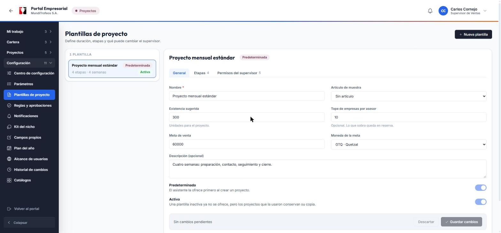

Cada plantilla tiene tres pestañas:

1. **General:** nombre, artículo de muestra, existencia sugerida, tope por asesor, meta de venta y su moneda, y si es la **predeterminada** o está **activa**.
2. **Etapas:** los tramos del mes (por ejemplo, Preparación, Contacto, Seguimiento y Cierre) con su duración en días hábiles. Con esto el sistema propone las fechas.
3. **Permisos del supervisor:** para cada dato (artículo, existencia, meta, tope, fechas) eliges si el supervisor puede **editarlo**, si queda **bloqueado** (con candado) o si es **obligatorio** completarlo.

> **Tip:** una plantilla inactiva ya no se ofrece, pero los proyectos que la usaron **conservan su copia**.

# 6. Reglas y aprobaciones

Tres interruptores que cambian cómo fluye el trabajo.

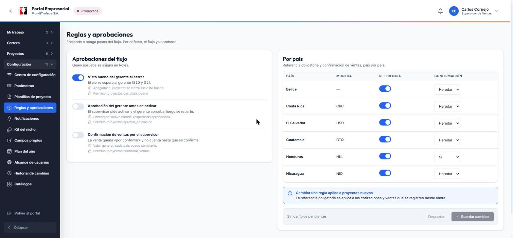

| Regla | Qué hace cuando está encendida |
|---|---|
| **Visto bueno del gerente al cerrar** | El cierre de un proyecto espera la decisión del gerente |
| **Aprobación del gerente antes de activar** | El supervisor **pide** la activación y el proyecto no se reparte hasta que el gerente apruebe |
| **Confirmación de ventas por el supervisor** | Las ventas quedan «por confirmar» y no cuentan hasta que el supervisor las confirme |

A la derecha, la tabla **Por país** te deja decidir, país por país, si la **referencia** (número de cotización u orden de venta) es obligatoria y si la **confirmación de ventas** se **hereda** de la regla general, o es sí o no solo para ese país.

> **Importante:** estas reglas aplican a proyectos **nuevos**. Si cambias una regla a mitad de mes, los proyectos activos mantienen la anterior.

# 7. Notificaciones: qué avisa el sistema

Una tabla con **cada evento** del módulo y, para cada rol, un interruptor que decide si se avisa.

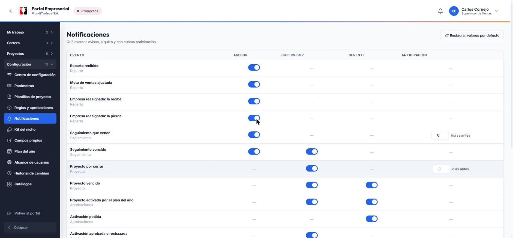

- Una raya (—) significa que ese evento **no aplica** a ese rol.
- En los recordatorios (como «Seguimiento que vence» o «Proyecto por cerrar») puedes elegir la **anticipación**: cuántas horas o días antes se avisa.
- **Restaurar valores por defecto** devuelve toda la tabla a como venía.

> **Nota:** el sistema **nunca avisa a quien hizo la acción** (si tú ajustas una meta, no te avisa a ti) y el aviso del mismo evento no se repite dos veces.

# 8. Kit del nicho

Para cada nicho puedes dejar **un guion de llamada y mensajes** de WhatsApp o correo. El asesor los abre desde la ficha de la empresa ya con los datos puestos.

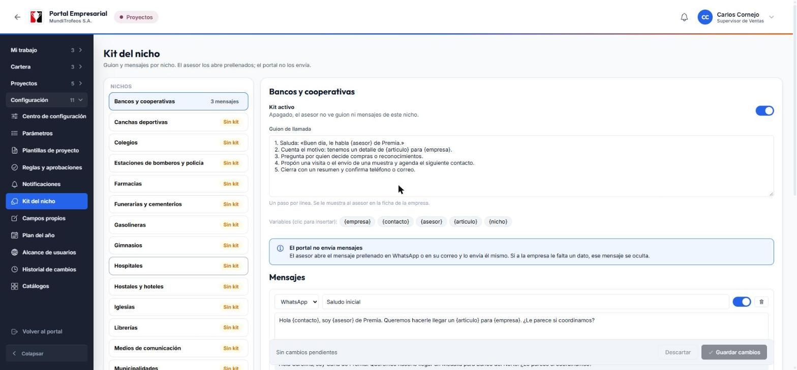

1. Elige el **nicho** en la lista de la izquierda.
2. Escribe el **guion de llamada**: un paso por línea.
3. Agrega **mensajes**: elige el canal (WhatsApp o correo), un título y el texto.
4. Para poner datos automáticos, toca una **variable**: `{empresa}`, `{contacto}`, `{asesor}`, `{articulo}` o `{nicho}`. El sistema las reemplaza al mostrarlas.
5. Debajo de cada mensaje ves una **vista previa con datos de ejemplo**.
6. Toca **Guardar cambios**.

> **Importante:** el portal **no envía** los mensajes. El asesor los abre en WhatsApp o en su correo y los envía él mismo. Si a una empresa le falta un dato (un correo, por ejemplo), ese mensaje queda **oculto** para ese asesor, con el motivo.

> **Ojo:** solo existen las cinco variables de arriba. Si escribes otra (como `{cliente}`), el sistema no deja guardar y te dice cuál.

# 9. Campos propios

Son **datos extra** que quieres pedir de cada empresa, según el nicho (por ejemplo, «¿Ya es cliente de Premia?»).

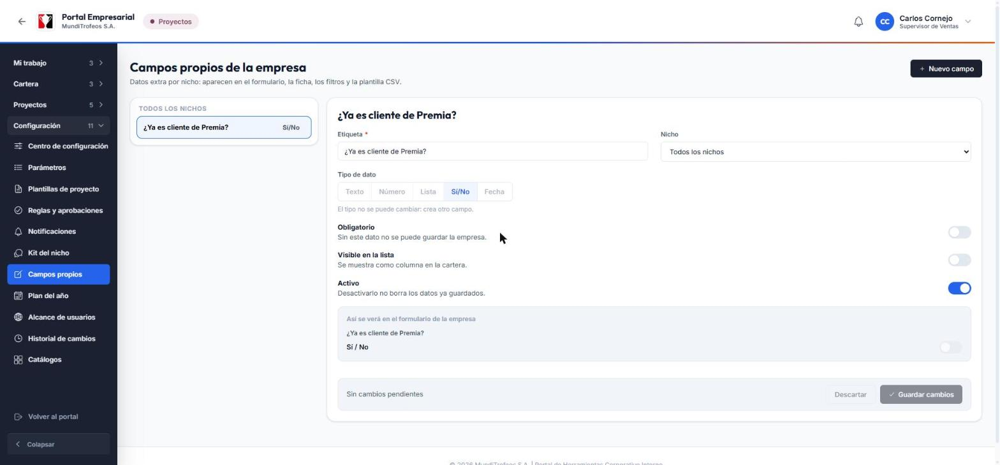

1. Toca **Nuevo campo**.
2. Escribe la **etiqueta** (lo que verá la gente) y, si quieres, limítalo a **un nicho**.
3. Elige el **tipo**: Texto, Número, Lista, Sí/No o Fecha. El tipo **no se puede cambiar** después.
4. Decide si es **obligatorio** y si se **muestra en la lista** de la cartera.
5. Guarda. El campo aparece en el formulario de la empresa, en la ficha, en los filtros y en la plantilla del CSV de importación.

> **Nota:** desactivar un campo **no borra** los datos ya guardados.

# 10. Plan del año y activación automática

Aquí planificas qué nicho se trabaja cada mes y, si quieres, dejas que el sistema **cree y active el proyecto solo**.

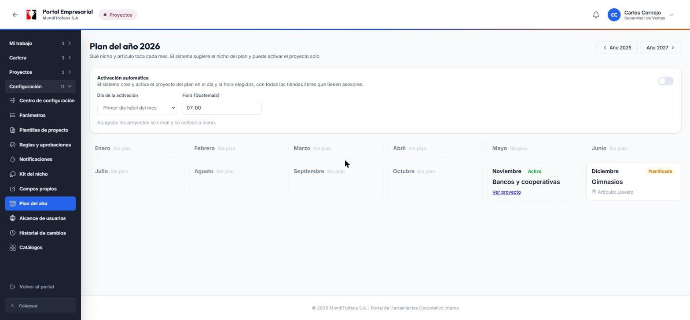

## Planificar un mes

1. Toca **Planificar** en el mes que quieras (o toca el mes si ya tiene plan).
2. Elige el **nicho** y, si quieres, el **artículo** y la **plantilla**.
3. Guarda. El mes queda **Planificado**.

El plan **sugiere el nicho** cuando un supervisor crea el proyecto de ese mes. Un mes que ya pasó, o que ya tiene un proyecto activo o cerrado, **no se puede cambiar**. Para quitar un mes del plan, ábrelo y toca **Quitar del plan**.

> **Nota:** el plan es **uno solo para toda la región**. Los meses que ya pasaron sin plan salen apagados.

## Activación automática

El interruptor del panel de arriba hace que el sistema **cree y active el proyecto del mes por ti**.

1. Enciende **Activación automática**.
2. Elige el **día** (por defecto, el primer día hábil del mes) y la **hora** (hora de Guatemala).
3. Debajo verás la **próxima activación** y un aviso si ese mes no tiene plan.

Cuando llega el momento, el sistema crea el proyecto con el plan, usando **todas las tiendas libres que tienen asesores**. Si exigiste aprobación del gerente, el proyecto queda esperando su aprobación; si no, se activa y reparte.

> **Importante:** si no se puede activar (el mes no tiene plan, no hay tiendas libres con asesores, no hay empresas del nicho…), **no se crea nada** y **tú recibes un aviso con el motivo**. El aviso no se repite por el mismo motivo en el mismo mes. Un mes que ya tiene proyecto, aunque sea manual, no se vuelve a crear.

> **Tip:** quien enciende el interruptor queda como **creador** de los proyectos automáticos.

# 11. Alcance de usuarios

Por defecto, cada persona ve las empresas **del país de su tienda**. Aquí lo amplías o lo reduces.

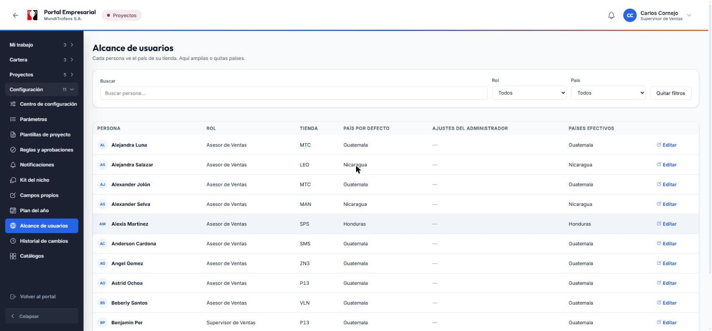

1. Busca a la persona (o filtra por rol o por país).
2. Toca **Editar**.
3. **Agrega** países que debe ver además de los suyos, o **quita** alguno.

Las excepciones quedan en la columna **Ajustes del administrador** y los países finales en **Países efectivos**.

# 12. Historial de cambios y cómo deshacer

Cada cambio de configuración queda registrado: **quién, cuándo, qué área, qué era antes y qué es ahora**.

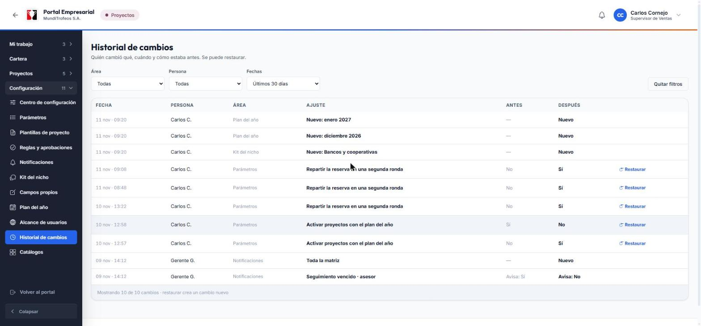

- Filtra por **área**, por **persona** y por **fechas**.
- Si un cambio fue un error, toca **Restaurar** en su fila. Eso **crea un cambio nuevo** que vuelve el valor anterior; el historial nunca se borra.

> **Nota:** no todo se puede restaurar desde aquí (por ejemplo, un alta de plan o de kit). En esos casos se corrige editando de nuevo.

# 13. Ideas para ponerlo en marcha

Un orden sugerido para la primera vez:

1. **Catálogos:** revisa nichos, artículos, canales y resultados; asigna la **moneda de cada país**.
2. **Parámetros:** deja los valores por defecto y ajusta solo si ya sabes qué quieres.
3. **Plantilla:** deja una **predeterminada** con sus etapas y qué puede cambiar el supervisor.
4. **Reglas:** decide si habrá visto bueno del gerente, aprobación de activación y confirmación de ventas.
5. **Alcance de usuarios:** revisa a quienes necesitan ver más de un país.
6. **Plan del año:** planifica los próximos meses y, cuando estés tranquilo, enciende la activación automática.
7. **Kit del nicho:** escribe el guion y los mensajes de los nichos de los primeros meses.
8. **Roles:** asigna los permisos y avisa al equipo.

# 14. Preguntas frecuentes

**Cambié un parámetro y el proyecto actual no lo tomó.**
Es normal: los proyectos activos conservan la configuración con la que nacieron. Aplica al siguiente.

**Un asesor dice que no ve el módulo.**
Revisa que su rol tenga el permiso de entrar y pídele que cierre sesión y vuelva a entrar.

**El sistema no activó el proyecto del mes.**
Mira la campana: el aviso dice el motivo (sin plan, sin tiendas libres, sin empresas del nicho…). Corrígelo y el sistema lo intentará de nuevo en la siguiente revisión.

**Me equivoqué en un ajuste.**
Ve al **Historial de cambios** y toca **Restaurar** en esa fila.

**¿Puedo borrar un nicho o un artículo?**
No se borran: se **desactivan**. Así los proyectos antiguos siguen mostrando su información.

**Una empresa quedó sin moneda o sin país.**
Revisa **Catálogos › Países** y asigna la moneda local y el formato de teléfono.

# 15. Glosario

| Palabra | Qué significa |
|---|---|
| **Catálogo** | Una lista de opciones que se elige en el módulo |
| **Parámetro** | Un número o una regla que ajusta el comportamiento |
| **Plantilla** | El molde para crear proyectos |
| **Interruptor** | Una regla que se enciende o se apaga |
| **Foto de la configuración** | La copia de la configuración con la que nace un proyecto |
| **Kit del nicho** | El guion y los mensajes de un nicho |
| **Variable** | Un dato que se reemplaza solo, como `{empresa}` |
| **Plan del año** | El nicho que toca cada mes |
| **Alcance** | Los países que ve una persona |
