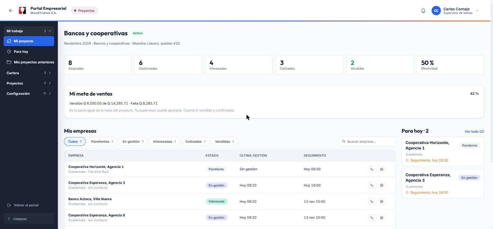
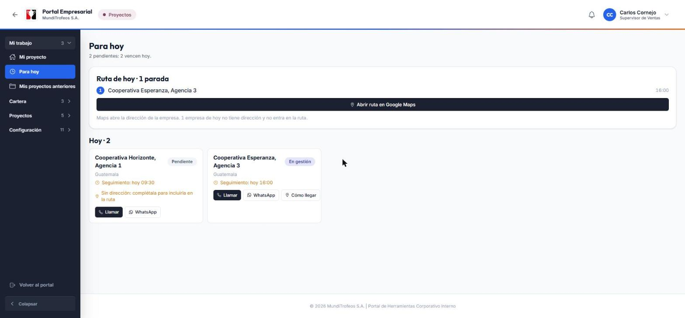
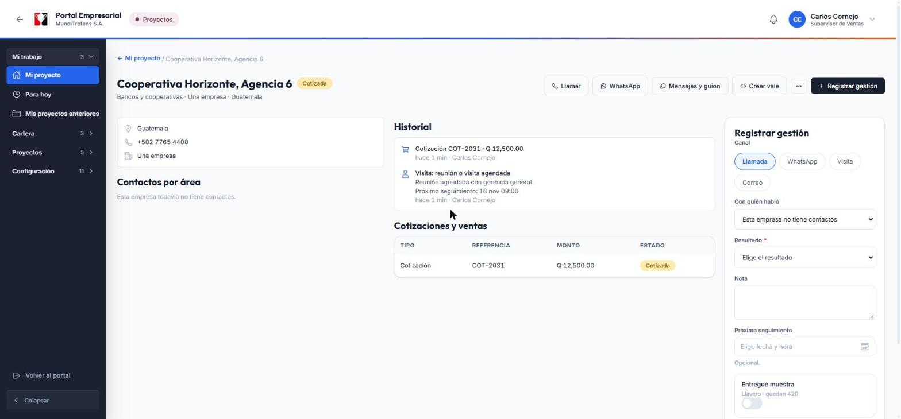
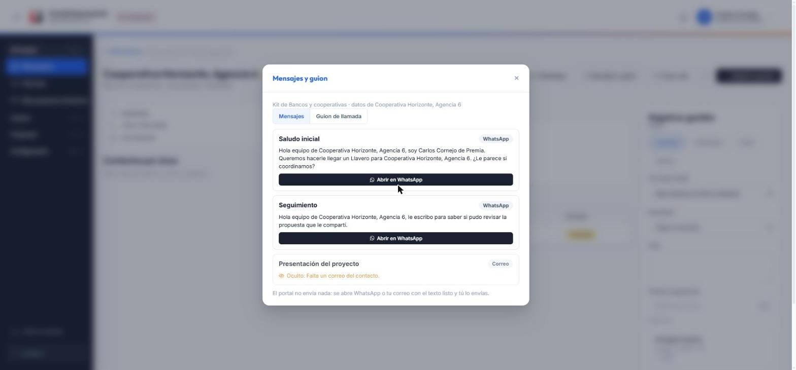
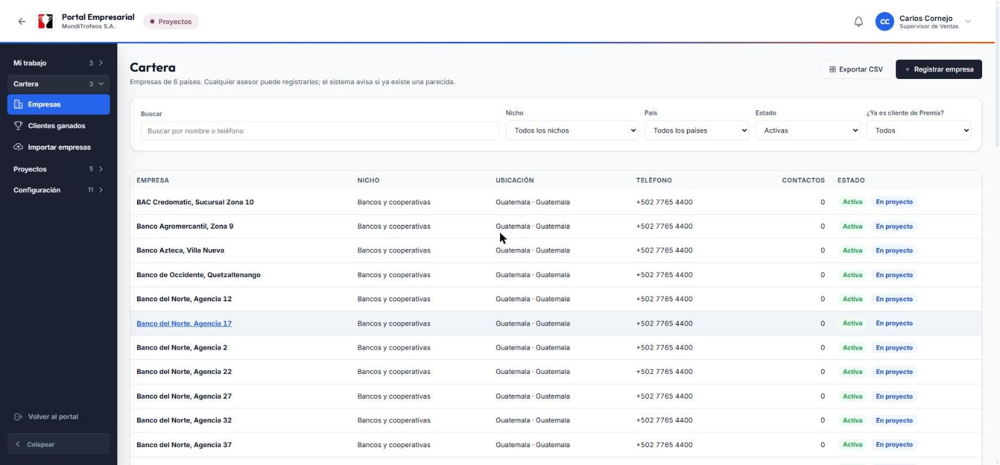
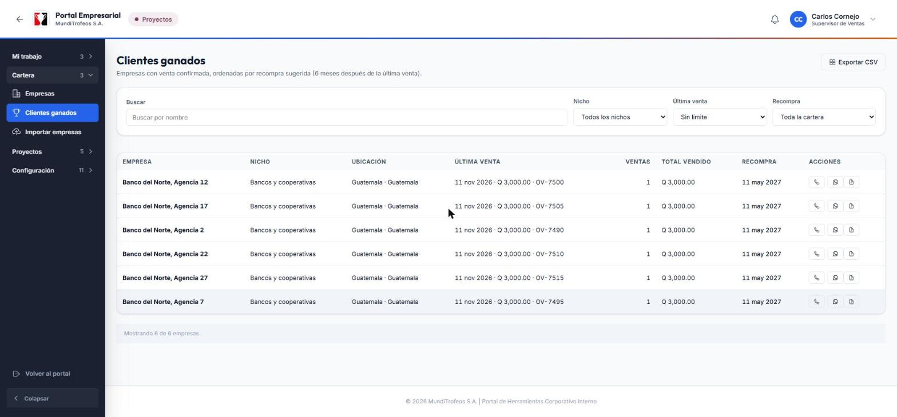

# Asesor · Cómo trabajar tus empresas del mes, paso a paso

# 1. Antes de empezar

## ¿Para qué sirve el módulo Proyectos?

Cada mes la empresa trabaja **un nicho** (por ejemplo, Bancos y cooperativas). El sistema reparte las empresas de ese nicho entre los asesores y tú te encargas de **contactarlas, ofrecerles el producto del mes y registrar lo que pasa**. Con lo que registras, tu supervisor ve el avance y gerencia mide cuánto se vendió.

Tu trabajo en el módulo se resume en tres ideas:

- **Contactar:** llamar, escribir por WhatsApp, visitar o enviar un correo.
- **Registrar:** anotar cada gestión, cada cotización y cada venta. Es lo que hace que tu esfuerzo cuente.
- **Dar seguimiento:** el sistema te recuerda a quién tienes que volver a contactar y cuándo.

> **Tip:** no tienes que recordar nada de memoria. La pantalla **Para hoy** te dice qué hacer ahora mismo.

## Qué vas a encontrar en el menú

El menú de la izquierda tiene **categorías** que se abren y se cierran. Solo ves las que te tocan:

| Categoría | Qué hay dentro |
|---|---|
| **Mi trabajo** | Mi proyecto (tu tablero), Para hoy y Mis proyectos anteriores |
| **Cartera** | Empresas (la base de datos), Clientes ganados y, si tu rol lo permite, Importar empresas |

> **Nota:** la categoría donde estás se abre sola y tu pantalla aparece resaltada. Si quieres ir a otra, toca el nombre de la categoría y elige.

**En el celular** el menú es el botón de tres rayitas (arriba a la izquierda) o la opción **Más** de la barra de abajo. Esa barra tiene cuatro botones: Mi proyecto, Para hoy, Cartera y Más.

## Tu mes en 5 pasos

1. Cuando el supervisor activa el proyecto, **te llega un aviso** con cuántas empresas te tocaron.
2. Entras a **Mi proyecto** y ves tu lista.
3. Cada día abres **Para hoy** y trabajas lo que está vencido, lo de hoy y lo que lleva días sin tocarse.
4. Por cada contacto, **registras la gestión**. Si hay interés, registras la **cotización**; si compran, la **venta**.
5. Al final del mes el supervisor cierra el proyecto y tus resultados quedan guardados en **Mis proyectos anteriores**.

# 2. Mi proyecto: tu tablero

Es la primera pantalla que ves. Aquí está todo tu mes de un vistazo.

## Qué significa cada parte

- **Encabezado:** el nicho del mes, las fechas y cuántas **muestras** quedan del artículo que se está ofreciendo.
- **Las seis cifras:** *Asignadas* (las empresas que te tocaron), *Gestionadas* (con las que ya hiciste algo), *Interesadas*, *Cotizadas*, *Vendidas* y *Efectividad* (qué porcentaje de tus empresas mostró interés).
- **Mi meta de ventas:** aparece cuando el proyecto tiene meta. Muestra cuánto llevas vendido, cuánto falta y el porcentaje. Tu meta es **tu parte igual** de la meta del proyecto; tu supervisor puede ajustarla. Solo cuenta lo vendido y **confirmado**.
- **Para hoy:** un resumen de lo urgente, con el enlace **Ver todo**.
- **Mis empresas:** tu lista completa. Puedes filtrar por estado (Pendientes, En gestión, Interesadas, Cotizadas, Vendidas) y buscar por nombre.

> **Tip:** toca el nombre de una empresa para abrir su ficha y trabajar con ella.

## Los estados de una empresa

El estado lo calcula el sistema según lo que tú registras. **Solo sube**, nunca baja por error:

| Estado | Cuándo aparece |
|---|---|
| **Pendiente** | Todavía no has registrado nada con esa empresa |
| **En gestión** | Ya hubo al menos un contacto o una gestión |
| **Interesada** | Mostró interés: pidió reunión, cotización o muestra |
| **Cotizada** | Le registraste una cotización |
| **Vendida** | Se registró una venta confirmada |
| **Perdida** / **Descartada** | Tú la marcaste así (te explicamos cómo más adelante) |

# 3. Para hoy: lo que toca ahora

Abre esta pantalla cada mañana. Te ordena el trabajo en tres grupos.

- **Vencidos:** seguimientos que debías hacer en un día anterior y siguen pendientes. Salen en rojo.
- **Hoy:** los seguimientos que tienes programados para hoy.
- **Sin tocar hace N días:** empresas a las que no les has registrado nada en varios días.

Cada tarjeta tiene botones para **Llamar** (abre el teléfono del celular) y **WhatsApp** (abre el chat). El portal **nunca envía nada por sí solo**: tú decides cuándo mandar el mensaje.

## La ruta del día

Si vas a visitar empresas, la tarjeta **Ruta de hoy** junta las de hoy que tienen dirección, ordenadas por la hora de tu seguimiento.

1. Toca **Abrir ruta en Google Maps**.
2. Maps abre con todas las paradas. Puedes reordenarlas allá si te conviene otro recorrido.
3. Para ir a una sola empresa, usa el botón **Cómo llegar** de su tarjeta.

> **Importante:** una empresa **sin dirección registrada** no entra en la ruta y no muestra «Cómo llegar». La tarjeta te lo avisa: «Sin dirección: complétala para incluirla en la ruta». Pide a tu supervisor o completa el dato en su ficha.

# 4. Trabajar una empresa

La **ficha** de la empresa es tu lugar de trabajo. Se abre al tocar el nombre de cualquier empresa.

## Qué hay en la ficha

- **Arriba:** el nombre, su estado y los botones **Llamar**, **WhatsApp**, **Correo**, **Mensajes y guion**, **Crear vale** y el menú **···** con más acciones.
- **A la izquierda:** los datos de la empresa y sus **contactos por área** (gerencia, compras, mercadeo…).
- **En el centro:** el **historial** (todo lo que se ha hecho) y las cotizaciones y ventas.
- **A la derecha:** el panel **Registrar gestión**. En el celular se abre desde el botón **Registrar gestión**.

## Registrar una gestión (lo que más vas a hacer)

Una gestión es cada contacto que tienes con la empresa.

1. Abre la ficha y mira el panel **Registrar gestión**.
2. Elige el **Canal**: Llamada, WhatsApp, Visita o Correo.
3. Elige **Con quién habló** (si la empresa ya tiene contactos).
4. Elige el **Resultado**. Es lo único obligatorio. Por ejemplo: *Sin respuesta*, *Pide volver a llamar*, *Reunión o visita agendada*, *Pide cotización*, *Pide muestra*, *No le interesa por ahora*.
5. Escribe una **Nota** corta con lo importante.
6. Elige la fecha y hora del **Próximo seguimiento**. Con algunos resultados es obligatorio; el sistema te avisa.
7. Toca **Guardar gestión**.

> **Tip:** pon siempre un próximo seguimiento. Así la empresa aparecerá en **Para hoy** el día que toca y no se te olvida.

> **Importante:** cada gestión que registras **reemplaza** el seguimiento anterior de esa empresa. Si la dejas sin fecha, el seguimiento que tenía se borra y la empresa deja de aparecer en **Para hoy**. Cuando existe uno programado, el formulario te lo recuerda debajo del campo.

### Si entregaste una muestra

En el mismo panel activa **Entregué muestra**, escribe la **cantidad** y el **área** (por ejemplo, gerencia o compras). La existencia del artículo baja sola. Cuando quedan 20 unidades o menos (el administrador puede cambiar ese número), tu supervisor recibe un aviso.

## Mensajes y guion de llamada

El botón **Mensajes y guion** abre ayuda ya preparada para el nicho de la empresa.

- **Mensajes:** textos con el nombre de la empresa, el contacto, tu nombre y el artículo ya escritos. Toca **Abrir en WhatsApp** o **Abrir en correo** y envía tú el mensaje.
- **Guion de llamada:** los pasos sugeridos para la llamada.

> **Nota:** si a un mensaje le falta un dato (por ejemplo, el correo del contacto), aparece **oculto** con el motivo. Completa el dato en la ficha y vuelve a abrirlo.

## Registrar una cotización

1. En la ficha, abre el menú **···** y elige **Registrar cotización**.
2. Escribe el **monto** y elige la **moneda**.
3. Escribe el **número de la cotización** (la referencia).
4. Guarda. La empresa pasa a **Cotizada**.

## Registrar una venta

1. Menú **···** y **Registrar venta**.
2. Escribe el **monto**, la **moneda** y el **número de orden de venta** (la referencia).
3. Guarda. La empresa pasa a **Vendida**.

> **Importante:** si el administrador activó la confirmación de ventas, la venta queda **por confirmar** hasta que tu supervisor la confirme. Mientras tanto **no cuenta** en tus cifras ni en tu meta. Si escribes una referencia que ya existe, el sistema te avisa para que no dupliques.

## Crear un vale de arte desde la empresa

Si el cliente quiere avanzar con un vale, usa **Crear vale**. Se abre Vales de Arte con los datos del cliente **ya escritos** y, al guardarlo, el vale queda ligado a esa empresa. Solo ves el botón si tu rol puede crear vales.

## Marcar como perdida o descartar

- **Marcar como perdida:** el cliente dijo que no. Elige el motivo. Puedes reabrirla con una nueva gestión si cambia de opinión.
- **Descartar empresa:** la sacas de tu proyecto (por ejemplo, ya no existe). Hay que escribir el motivo.

## ¿Te equivocaste en un registro?

Los registros **no se borran ni se editan**: solo se agregan. Si algo quedó mal, avísale a tu supervisor: él puede **anular** esa cotización, venta o gestión con un motivo, y todo se recalcula solo.

# 5. Cartera y clientes ganados

## Cartera: la base de empresas

La **Cartera** reúne las empresas de tu país. Puedes buscar por nombre o teléfono y filtrar por nicho, país y estado.

### Registrar una empresa nueva

1. Toca **Registrar empresa**.
2. Llena el nombre, el nicho, el país, la ciudad, el teléfono y al menos un contacto con su área.
3. **Antes de guardar** el sistema revisa si ya existe una parecida (mismo nombre en la misma ciudad, o mismo teléfono). Si es la misma, ábrela en vez de crear otra.
4. Guarda.

> **Tip:** si registras una empresa del **nicho del proyecto activo** y tú participas, el sistema **te la asigna automáticamente**.

## Clientes ganados: la oportunidad de vender otra vez

Aquí están las empresas a las que ya se les **vendió y la venta fue confirmada**. Sirve para la posventa y la recompra.

- **Recompra:** la fecha sugerida para volver a contactar (por defecto, seis meses después de la última venta). Si ya pasó, sale en rojo.
- Cada fila tiene botones para **llamar**, **WhatsApp** y **Crear vale** de recompra.
- Puedes filtrar por nicho, por la última venta (3, 6, 12 o 24 meses) y por recompra vencida o próxima.
- Ves **las empresas que tú vendiste** (tu supervisor ve también las de sus tiendas).

# 6. Avisos: qué te avisa el sistema

Arriba a la derecha está la **campana**. Cada aviso trae un ícono y un texto. Los que recibes como asesor:

| Aviso | Cuándo te llega |
|---|---|
| **Reparto recibido** | Te asignaron empresas, al activarse el proyecto o desde la reserva |
| **Empresa reasignada** | Te pasaron una empresa, o te quitaron una |
| **Meta de ventas ajustada** | Tu supervisor cambió tu meta |
| **Seguimiento que vence / vencido** | Tienes un seguimiento próximo o que ya se pasó |
| **Venta confirmada o rechazada** | Tu supervisor revisó una venta que registraste |
| **Registro anulado** | Se anuló una cotización, venta o gestión tuya, con el motivo |

> **Nota:** nunca te avisan de lo que tú mismo haces.

# 7. Reglas que conviene recordar

- **Una empresa, un solo proyecto activo y un solo asesor.** Si una empresa es tuya, nadie más la trabaja.
- **Si el proyecto se cierra queda en solo lectura.** Verás los resultados en **Mis proyectos anteriores**, pero ya no puedes registrar nada.
- **Las empresas marcadas «no contactar»** (porque el cliente lo pidió) no entran en ningún reparto.
- **El portal no envía mensajes ni llama por ti.** Solo abre WhatsApp, el correo o el teléfono con todo listo.
- **Lo que registras es lo que se mide.** Una gestión sin registrar es una gestión que no existe para el informe.

# 8. Preguntas frecuentes

**No veo el proyecto ni mis empresas.**
Todavía no hay un proyecto activo en tu tienda o no te asignaron empresas. Pregunta a tu supervisor. La pantalla te lo dice con el mensaje «Sin proyecto activo».

**¿Por qué una empresa me sale «Sin dirección»?**
Porque no tiene la dirección registrada. Sin ella no puede entrar en la ruta de Google Maps ni mostrar «Cómo llegar».

**Registré una venta y mis cifras no cambiaron.**
Probablemente la venta está **por confirmar**. Cuando tu supervisor la confirme, se suma.

**Me equivoqué al registrar una gestión.**
Pide a tu supervisor que la anule con un motivo. Después registra la correcta.

**El mensaje de WhatsApp o de correo aparece oculto.**
Le falta un dato a la empresa, por ejemplo el teléfono o el correo del contacto. Complétalo en la ficha.

**¿Puedo usar el módulo desde el celular?**
Sí. Todo funciona en el celular: la barra de abajo te lleva a Mi proyecto, Para hoy, Cartera y al menú.

# 9. Glosario

| Palabra | Qué significa |
|---|---|
| **Proyecto** | El trabajo de un mes con un nicho y un artículo |
| **Nicho** | El tipo de empresas del mes: bancos, colegios, iglesias… |
| **Gestión** | Cada contacto con una empresa: llamada, WhatsApp, visita o correo |
| **Seguimiento** | La fecha en que debes volver a contactar a una empresa |
| **Muestra** | El artículo de ejemplo que se entrega a la empresa |
| **Cotización** | El precio que le ofreces, con su número |
| **Venta** | La compra confirmada, con su número de orden de venta |
| **Reserva** | Empresas que sobraron del reparto y se entregan después |
| **Recompra** | Volver a venderle a un cliente que ya compró |
| **Vale de arte** | El pedido que se genera en Vales de Arte para producir el trabajo |
