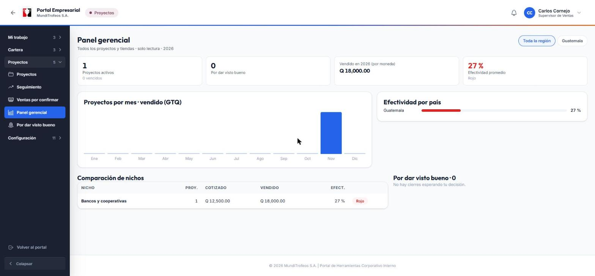
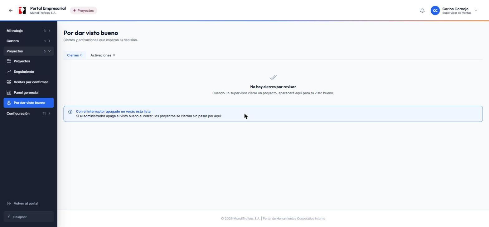
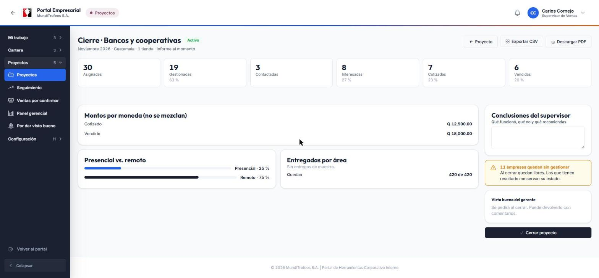
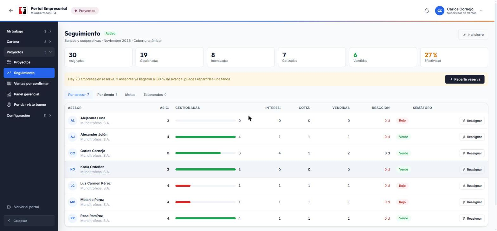

# Gerente · Ver cómo va todo, dar el visto bueno y aprobar

# 1. Antes de empezar

## Tu papel en el módulo

Eres quien **ve el panorama completo y toma las decisiones importantes**. No registras gestiones ni contactas clientes: miras cómo va el trabajo de todas las tiendas, **das el visto bueno a los cierres** y, si está encendido, **apruebas las activaciones** de proyectos.

Tu acceso es de **solo lectura** en el seguimiento: ves todo, en todos los países y tiendas, pero no cambias lo que hacen los supervisores y asesores.

## Qué hay en tu menú

El menú de la izquierda tiene **categorías** que se abren de a una. Para ti la más importante es **Proyectos**:

| Opción | Para qué sirve |
|---|---|
| **Panel gerencial** | El resumen de todo: proyectos, ventas, efectividad y comparaciones |
| **Seguimiento** | El avance de cada proyecto, por asesor, tienda y metas (solo lectura) |
| **Por dar visto bueno** | Los cierres (y las activaciones) que esperan tu decisión |
| **Por aprobar** | Los proyectos que esperan tu aprobación antes de repartirse (si está encendida) |

> **Tip:** al entrar a una pantalla, su categoría se abre sola y tu opción queda resaltada.

## Tus tres tareas

1. **Mirar** el panel gerencial cuando quieras saber cómo va el negocio.
2. **Decidir** los cierres que te llegan: dar visto bueno o devolver con comentarios.
3. **Aprobar** activaciones, si el administrador lo pidió.

# 2. El panel gerencial

Es tu pantalla de resumen.

## Cómo leerlo

- **Cifras de arriba:** *Proyectos activos* (y cuántos están vencidos), *Por dar visto bueno*, *Vendido en el año por moneda* y *Efectividad promedio* con su semáforo.
- **Proyectos por mes · vendido:** una barra por mes con lo vendido. Te deja ver en qué meses se vendió más.
- **Efectividad por país:** qué porcentaje de las empresas mostró interés en cada país, con su color.
- **Comparación de nichos:** una fila por nicho con cuántos proyectos tuvo, lo cotizado, lo vendido y su efectividad. Sirve para decidir qué nichos conviene repetir.
- **Por dar visto bueno:** los cierres que esperan tu decisión.

## Filtrar por país

Arriba a la derecha elige **Toda la región** o un país. Todo el panel se recalcula.

> **Importante:** el dinero **nunca se mezcla entre monedas**. Cada moneda tiene su propia cifra. Si una cifra aparece como Q (quetzales) y otra como US$ (dólares), no se suman.

> **Nota:** el color de la efectividad es un semáforo: verde si está bien, ámbar si está en riesgo y rojo si está por debajo de lo esperado. Los umbrales los define el administrador.

# 3. Dar el visto bueno a un cierre

Cuando un supervisor cierra un proyecto, el cierre **espera tu decisión** (si el administrador activó el visto bueno). Te llega un aviso y aparece en **Por dar visto bueno**.

## Paso a paso

1. Abre **Por dar visto bueno**. Verás las pestañas **Cierres** y **Activaciones**.
2. Entra al cierre que quieres revisar. Ves el **informe completo**: cifras, montos por moneda, presencial vs. remoto, muestras entregadas y las **conclusiones del supervisor**.
3. Si estás de acuerdo, toca **Dar visto bueno**.
4. Si algo no cuadra, escribe tu **comentario** (es obligatorio) y toca **Devolver con comentarios**.

> **Nota:** si lo devuelves, el supervisor corrige y lo **reenvía**. Tú recibes un nuevo aviso. El supervisor recibe un aviso con tu decisión, sea cual sea.

El informe que ves es **el informe congelado** al cerrar: no cambia aunque después se registre algo distinto. Puedes **descargarlo en PDF** o **exportarlo en CSV** para analizarlo en Excel.

> **Tip:** si el administrador apaga el visto bueno, los proyectos se cierran sin pasar por ti y esta lista aparecerá vacía. Es normal.

# 4. Aprobar una activación

Si el administrador encendió la **aprobación del gerente**, cuando un supervisor prepara un proyecto no puede activarlo solo: lo **pide**, y el proyecto queda en estado *Esperando aprobación*. Todavía no se reparte nada.

1. Te llega el aviso **Activación pedida**.
2. Abre **Por aprobar** (o la pestaña **Activaciones** de Por dar visto bueno).
3. Revisa el proyecto: el nicho, las tiendas, las fechas y la **vista previa del reparto** (cuántas empresas recibe cada asesor).
4. Toca **Aprobar y repartir** o **Rechazar con comentario**.

> **Importante:** al aprobar, **el reparto se hace en ese mismo momento**: se asignan las empresas y cada asesor recibe su aviso. Si rechazas, escribe qué debe corregir el supervisor.

> **Nota:** los proyectos que el sistema crea solo, con el **plan del año**, también pasan por aquí si esta aprobación está encendida.

# 5. Seguimiento en solo lectura

Con **Seguimiento** puedes meterte a cualquier proyecto activo, de cualquier tienda, y ver lo mismo que ve el supervisor: avance por asesor, por tienda, metas y empresas estancadas.

- **Por asesor y por tienda:** cuántas empresas tiene cada uno y qué tanto ha gestionado.
- **Metas:** cuánto lleva vendido cada asesor frente a su meta.
- **Estancados:** las empresas que llevan días sin gestión.

> **Nota:** aquí **no hay botones para reasignar ni ajustar**. Si ves algo que corregir, habla con el supervisor de esa tienda.

# 6. Avisos que recibes

Los avisos están en la **campana** (arriba a la derecha).

| Aviso | Cuándo te llega |
|---|---|
| **Cierre pendiente de visto bueno** | Un supervisor cerró un proyecto y espera tu decisión |
| **Activación pedida** | Un supervisor pide aprobar la activación de un proyecto |
| **Proyecto vencido** | Un proyecto pasó su fecha de fin y sigue sin cerrarse |
| **Proyecto activado por el plan del año** | El sistema creó solo el proyecto del mes (o lo dejó esperando tu aprobación) |

> **Tip:** el administrador puede encender o apagar cada aviso en la pantalla **Notificaciones**.

# 7. Preguntas frecuentes

**El panel no muestra nada del mes.**
Quizá todavía no hay proyectos activos o cerrados con ventas ese año. Mira otro mes o elige **Toda la región**.

**¿Por qué «Por dar visto bueno» está vacío?**
No hay cierres esperando tu decisión, o el administrador apagó el visto bueno.

**Devolví un cierre, ¿qué pasa ahora?**
El supervisor lo corrige y lo reenvía. Te llegará otro aviso.

**No veo la opción «Por aprobar».**
Solo aparece si tu rol tiene el permiso de aprobar activaciones. Pídeselo al administrador.

**¿Por qué las cifras de dinero están separadas?**
Porque cada país vende en su moneda y el sistema no convierte ni mezcla monedas.

**¿Puedo ver los datos de contacto de los clientes?**
Ves todo el detalle de todas las tiendas en solo lectura, pero tus decisiones se toman sobre los informes y las cifras.

# 8. Glosario

| Palabra | Qué significa |
|---|---|
| **Visto bueno** | Tu revisión de un cierre antes de que quede definitivo |
| **Activación** | El momento en que un proyecto reparte sus empresas y empieza |
| **Efectividad** | El porcentaje de empresas que mostró interés |
| **Cobertura** | Qué tanto de lo asignado ya se gestionó |
| **Semáforo** | Verde, ámbar o rojo según qué tan bien va |
| **Informe congelado** | El informe que se guarda al cerrar y ya no cambia |
| **Plan del año** | El calendario de nichos por mes definido por el administrador |
