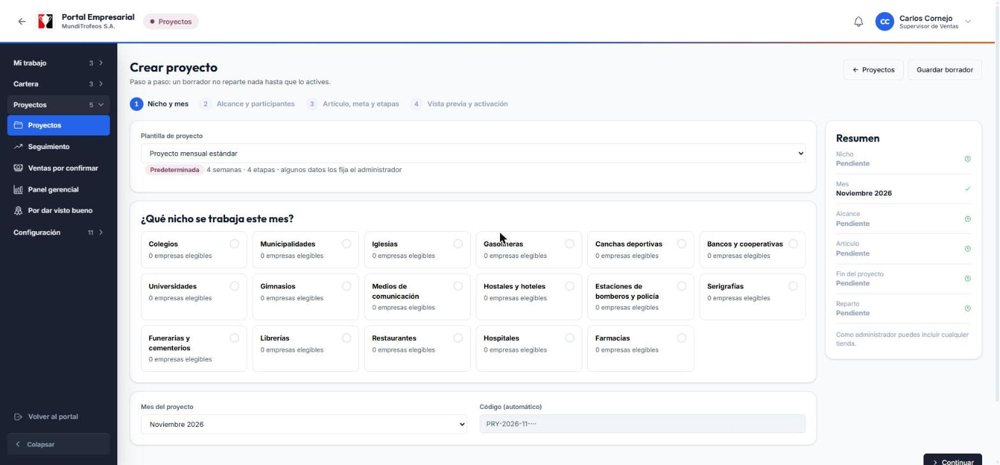
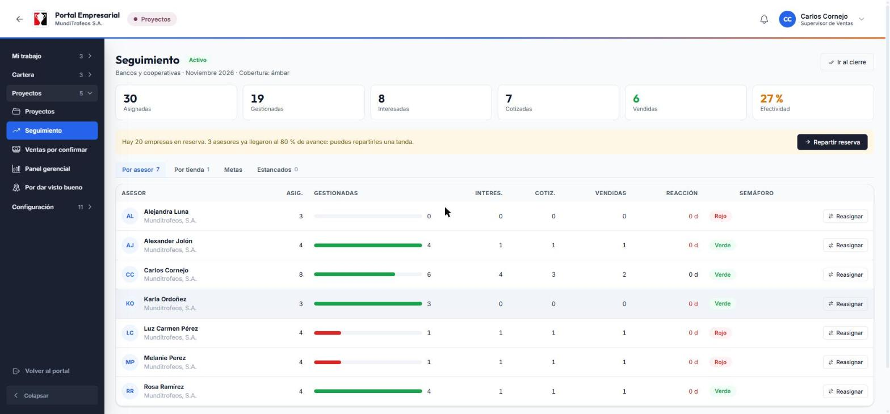
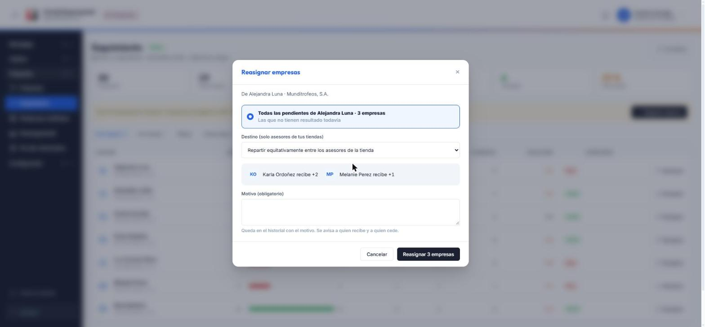
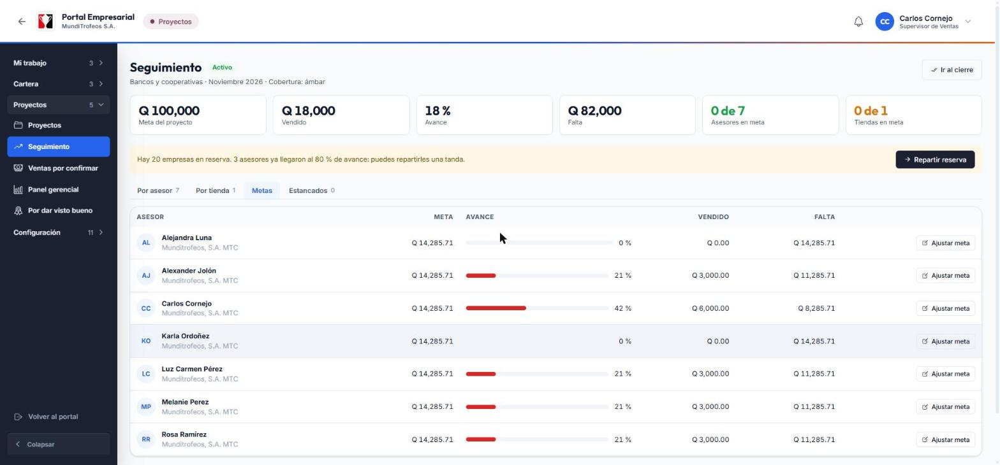
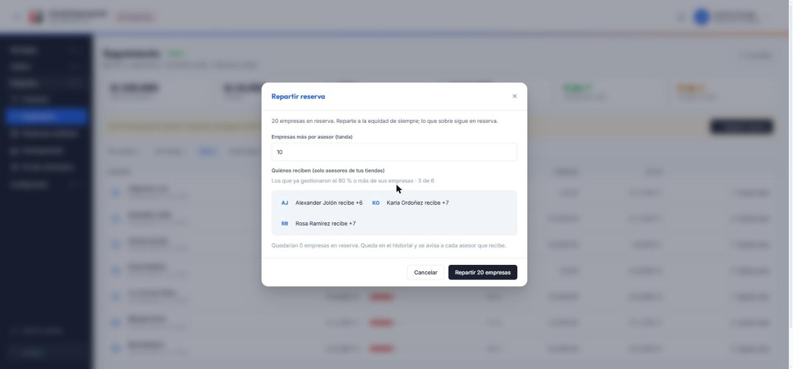
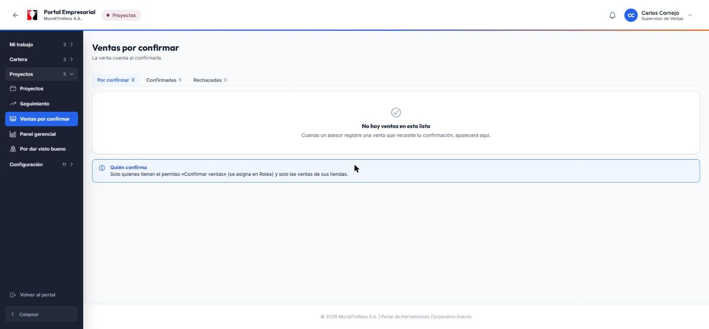
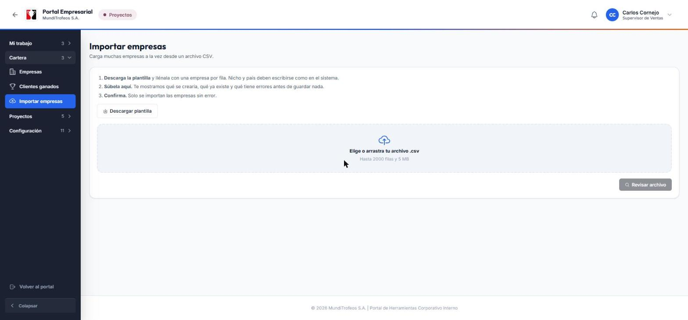
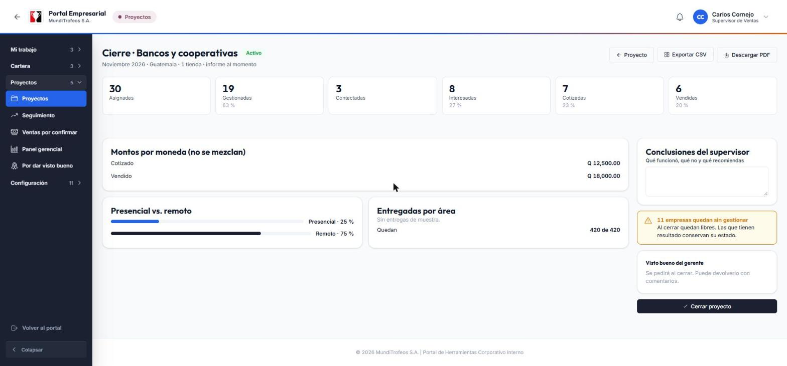

# Supervisor · Prepara el mes, da seguimiento y cierra el proyecto

# 1. Antes de empezar

## Tu papel en el módulo

Eres quien **prepara el proyecto del mes, lo activa, acompaña a los asesores y lo cierra**. Los asesores contactan y registran; tú ves cómo van, ayudas a quien se atrasa y te aseguras de que al final el informe cuente lo que realmente pasó.

Tu ciclo de trabajo es este:

1. **Preparar:** creas el proyecto, eliges el nicho, las tiendas y los asesores, y revisas el reparto.
2. **Activar:** al activarlo, el sistema reparte las empresas y avisa a cada asesor.
3. **Dar seguimiento:** miras el avance, ayudas a los atrasados, reasignas, ajustas metas y confirmas ventas.
4. **Cerrar:** revisas el informe, escribes tus conclusiones y cierras. Si hay gerente que lo revise, pide su visto bueno.

## Qué ves y qué puedes hacer

Solo ves y tocas lo de **las tiendas que supervisas**. Lo de otras tiendas, si aparece, sale **con candado y solo para leer**: sin contactos ni montos.

Tu menú tiene estas categorías:

| Categoría | Lo que hay dentro |
|---|---|
| **Mi trabajo** | Tu propio tablero, si también trabajas empresas |
| **Cartera** | Empresas, Clientes ganados e **Importar empresas** |
| **Proyectos** | **Proyectos**, **Seguimiento**, **Ventas por confirmar** (si el administrador la activó) y el **Panel gerencial** en solo lectura |

> **Tip:** las categorías se abren de a una. Al entrar a una pantalla, su categoría se abre sola.

# 2. Crear y activar un proyecto

Abre **Proyectos** y toca **Crear proyecto**. Es un asistente de **cuatro pasos**. Puedes guardar un borrador en cualquier momento y retomarlo después; un borrador **no reparte nada**.

## Paso 1 · Nicho y mes

1. Elige la **plantilla** (viene marcada la predeterminada). Te dice cuántas semanas y etapas tiene.
2. Elige el **nicho** del mes. Cada tarjeta muestra cuántas empresas **elegibles** hay.
3. Confirma el **mes**. El código del proyecto se genera solo.

> **Nota:** si el administrador planificó ese mes en el **Plan del año**, verás un aviso azul con el nicho sugerido y ya viene elegido. Puedes cambiarlo; con **Usar la sugerencia del plan** lo recuperas.

## Paso 2 · Alcance y participantes

1. Elige las **tiendas** que participan. Una tienda solo puede estar en **un proyecto activo a la vez**; las ocupadas salen bloqueadas.
2. Revisa los **asesores** de esas tiendas. Si alguien no puede participar (vacaciones, ausencia), **exclúyelo y escribe el motivo**.

## Paso 3 · Artículo, meta y etapas

- **Artículo de muestra** y su **existencia** (cuántas unidades hay para entregar).
- **Tope de empresas por asesor** (opcional). Lo que sobre queda en **reserva**.
- **Meta de ventas** y su moneda (opcional). Se reparte en partes iguales entre los asesores.
- **Fechas del proyecto y de cada etapa.** El sistema las propone con el calendario laboral.

> **Importante:** lo que el administrador **bloqueó** en la plantilla aparece con candado y no se puede cambiar; lo que marcó como **obligatorio** hay que completarlo antes de activar.

## Paso 4 · Vista previa y activación

Antes de activar ves **cómo quedaría el reparto**, sin guardar nada: cuántas empresas recibe cada asesor y cada tienda, cuántas quedan **en reserva**, cuántas **sin asesor** (por ejemplo, un país sin asesores participantes) y quién fue excluido.

- Si todo está bien, toca **Activar proyecto**. En ese momento se asignan las empresas y **cada asesor recibe su aviso**.
- Si el administrador exige aprobación del gerente, el botón será **Pedir aprobación**. El proyecto queda **esperando aprobación** y no se reparte hasta que el gerente apruebe.

> **Ojo:** una empresa solo puede estar en **un proyecto activo**. Si otro proyecto toma una empresa justo antes que tú, el sistema te lo dice y te pide volver a ver la vista previa.

## Si tienes que cancelar

Desde la lista de **Proyectos**, un proyecto activo se puede **cancelar** (con motivo) y un borrador se puede **descartar**. Las empresas vuelven a quedar libres.

# 3. Dar seguimiento

Abre **Seguimiento**. Es tu pantalla de todos los días.

## Las cifras de arriba

Asignadas, Gestionadas, Interesadas, Cotizadas, Vendidas y Efectividad de **todo el proyecto**. Debajo, la **cobertura** (gestionadas sobre asignadas) con su color: verde, ámbar o rojo.

## Las cuatro pestañas

- **Por asesor:** una fila por asesor con su avance, **reacción** (días que tardó en su primera gestión) y **semáforo**. Desde aquí puedes **Reasignar**.
- **Por tienda:** lo mismo, agrupado por tienda.
- **Metas:** la meta y el avance de ventas de cada asesor (si el proyecto tiene meta).
- **Estancados:** empresas que llevan varios días sin gestión. Puedes elegir varias y reasignarlas.

## Reasignar empresas

Sirve cuando un asesor se atrasa, se ausenta o tiene demasiadas.

1. En **Por asesor** toca **Reasignar** en la fila del asesor (o elige empresas en **Estancados**).
2. Elige el **destino**: **repartir equitativamente** entre los asesores de la tienda o un asesor en concreto.
3. Mira la **vista previa** de quién recibe cuántas.
4. Escribe el **motivo** (es obligatorio).
5. Toca **Reasignar**.

> **Nota:** la empresa pasa con **todo su historial y su estado**. Queda registrado y se avisa a quien recibe y a quien cede. Solo puedes reasignar empresas de asesores de **tus** tiendas.

## Metas de ventas

Si el proyecto tiene meta, la pestaña **Metas** la muestra por asesor.

- La meta del proyecto se **reparte en partes iguales**. Para cambiar la de un asesor de tu tienda toca **Ajustar meta**, escribe el monto y guarda. **Dejarlo vacío** vuelve a la parte igual.
- Ajustar una meta **no cambia las demás**: la suma puede pasar o quedar por debajo de la meta del proyecto.
- El avance cuenta lo vendido y **confirmado** en la moneda de la meta. Las ventas en otras monedas se muestran aparte, sin mezclar.
- El asesor recibe un aviso cuando le ajustas la meta.

## Repartir la reserva por tandas

Si al activar sobraron empresas (porque todos llegaron al tope), quedaron **en reserva**. Cuando alguien avanza, puedes darle más.

1. Aparece un aviso amarillo: «Hay N empresas en reserva». Toca **Repartir reserva**.
2. Elige la **tanda**: cuántas empresas más recibe cada asesor (por ejemplo, 10).
3. Reciben **solo los asesores de tus tiendas que ya gestionaron el 80 % o más** de sus empresas (el administrador puede cambiar ese porcentaje).
4. Revisa la vista previa y toca **Repartir**.

> **Importante:** esta opción solo existe si el administrador **encendió las rondas de reparto**. Si nadie llegó al porcentaje, el sistema te lo explica y no reparte nada.

## Ver el detalle de una empresa y corregir errores

Toca el nombre de una empresa (por ejemplo, en **Estancados**) para ver su ficha de supervisión: su historial, cotizaciones y ventas. Si un asesor se equivocó, puedes **anular** una gestión, cotización o venta escribiendo el **motivo**. El estado y las cifras se recalculan solos y se avisa al asesor.

> **Ojo:** anular exige tu permiso de **corregir** y solo vale en proyectos activos. Una venta anulada deja de contar en todo.

# 4. Ventas por confirmar

Si el administrador activó la **confirmación de ventas**, las ventas que registran los asesores quedan **por confirmar** y **no cuentan** hasta que tú las apruebes.

1. Abre **Ventas por confirmar**.
2. En **Por confirmar** revisa cada venta: empresa, asesor, monto y referencia.
3. Toca **Confirmar** para que cuente, o **Rechazar** escribiendo el motivo.
4. Las listas **Confirmadas** y **Rechazadas** guardan el historial.

> **Nota:** solo ves las ventas de tus tiendas y necesitas el permiso **Confirmar ventas**. Al decidir, el asesor recibe un aviso.

# 5. Importar empresas desde un archivo

Cuando tienes una lista grande de empresas, no hace falta registrarlas una por una.

1. Toca **Descargar plantilla** y llénala: una empresa por fila. El **nicho y el país** deben escribirse como están en el sistema.
2. Súbela en el recuadro (archivo **.csv**, hasta **2000 filas y 5 MB**).
3. Toca **Revisar archivo**. El sistema te muestra qué se **crearía**, qué **ya existe** y qué **tiene errores**, **sin guardar nada**.
4. Si te parece bien, **confirma**. Solo se importan las filas sin error, y puedes bajar un archivo con los errores para corregirlos.

> **Tip:** guarda el archivo desde Excel como «CSV». Si usa punto y coma o tiene tildes, el sistema lo entiende igual.

# 6. Cerrar el proyecto

Cuando termina el mes, abre **Proyectos**, entra al proyecto y toca **Ir al cierre**.

El informe se calcula con lo que realmente se registró:

- **Cifras:** asignadas, gestionadas, contactadas, interesadas, cotizadas y vendidas, con su porcentaje.
- **Montos por moneda:** lo cotizado y lo vendido, **sin mezclar monedas**.
- **Presencial vs. remoto:** qué parte de las gestiones fue visita y cuál fue llamada, WhatsApp o correo.
- **Entregadas por área:** las muestras que se entregaron y cuántas quedaron.

### Cómo cerrar

1. Revisa el informe y fíjate en el aviso de **empresas sin gestionar**: al cerrar quedan **libres** para otro proyecto; las que tienen resultado conservan su estado.
2. Escribe tus **conclusiones**: qué funcionó, qué no y qué recomiendas.
3. Toca **Cerrar proyecto** y confirma. El proyecto pasa a **solo lectura** y el informe se **congela**: ya no cambia aunque después se corrija algo.

> **Importante:** si el administrador activó el **visto bueno del gerente**, tu cierre queda **esperando su decisión**. Si lo devuelve con comentarios, corriges y usas **Reenviar al gerente**. Te llega un aviso cuando lo dé.

También puedes **Descargar PDF** del informe y **Exportar CSV**: los resultados del proyecto (una fila por empresa) o las tablas del informe, listas para Excel.

> **Nota:** si pasan unos días de la fecha de fin sin que lo cierres, el proyecto aparece como **vencido** y recibes un aviso. Nada se cierra solo.

# 7. Avisos que recibes

| Aviso | Cuándo te llega |
|---|---|
| **Existencia de muestras baja** | La existencia del artículo baja a 20 unidades o menos (una sola vez; el administrador puede cambiar el número) |
| **Seguimiento vencido** | Un asesor de tus tiendas dejó pasar un seguimiento |
| **Venta por confirmar** | Un asesor registró una venta que debes revisar |
| **Proyecto por cerrar / vencido** | Se acerca o pasó la fecha de fin |
| **Visto bueno dado o devuelto** | El gerente decidió sobre tu cierre |
| **Activación aprobada o rechazada** | El gerente decidió sobre una activación que pediste |
| **Proyecto activado por el plan del año** | El sistema creó solo el proyecto del mes |

# 8. Preguntas frecuentes

**No puedo elegir una tienda al crear el proyecto.**
Esa tienda ya está en otro proyecto activo. Una tienda participa en un solo proyecto a la vez. Espera a que cierre o quítala del otro proyecto.

**Una empresa no apareció en el reparto.**
Puede estar marcada «no contactar», estar en otro proyecto activo o estar en descanso por una venta reciente (el administrador define cuántos meses). También cuenta el país: solo se reparte a asesores del mismo país.

**¿Por qué algunas empresas quedaron en reserva?**
Porque todos los asesores llegaron al tope que pusiste. Se pueden repartir después por tandas.

**Un asesor se fue de vacaciones a mitad de mes.**
Usa **Reasignar** para pasar sus pendientes a los demás.

**Registré mal un cierre.**
Un proyecto cerrado queda en solo lectura. Pide al administrador si hay algo que corregir.

**¿Puedo ver proyectos de otras tiendas?**
Los ves con candado y solo en lo general. No puedes actuar sobre ellos.

# 9. Glosario

| Palabra | Qué significa |
|---|---|
| **Reparto** | Dividir las empresas entre los asesores, una por una al que tiene menos |
| **Reserva** | Empresas que sobraron por el tope y se reparten después |
| **Tope** | El máximo de empresas que recibe cada asesor al inicio |
| **Cobertura** | Gestionadas sobre asignadas: qué tanto se ha trabajado |
| **Semáforo** | Verde, ámbar o rojo según la cobertura |
| **Reacción** | Cuánto tardó un asesor en su primera gestión |
| **Estancada** | Empresa que lleva varios días sin gestión |
| **Visto bueno** | La revisión del gerente sobre tu cierre |
| **Plan del año** | El calendario de nichos por mes que define el administrador |
